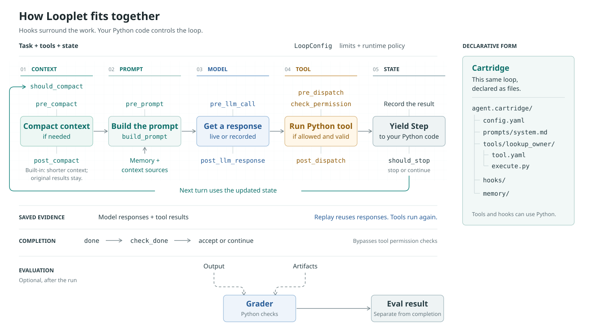

# Python quickstart

Build a tool-calling agent from a Python function.
Run it offline first.
Then add limits, a permission hook, and saved responses to the same loop.

## Install

This guide uses an **unreleased source preview**.
The Python-first API is not in published `0.4.1`.
Use the fixed revision below for every example on this page.
For PyPI `0.4.1`, use the [released walkthrough](quickstart.md).

Python 3.11 or newer is required.
Create a virtual environment and install the preview:

```bash
python -m venv .venv-looplet
. .venv-looplet/bin/activate
python -m pip install "looplet @ https://github.com/hsaghir/looplet/archive/e4663644bf9572153975bae8db8f170d8aa46341.zip"
```

Installation needs network access, but no Git checkout.
Keep this environment active.
The first example needs no model key or model service.

<a id="write-one-loop"></a>
<a id="test-without-a-model-service"></a>

## Run one loop

The task is to find the team that owns payments.
The tool reads a small service directory.
The scripted backend supplies two fixed model responses.

```python title="first_loop.py"
from looplet import MockLLMBackend, composable_loop


def lookup_owner(service: str) -> str:
    """Find the team that owns a service."""
    owners = {"payments": "fintech-platform", "search": "discovery"}
    return owners.get(service, "unknown")


responses = [
    '{"tool":"lookup_owner","args":{"service":"payments"}}',
    '{"tool":"done","args":{"summary":"fintech-platform"}}',
]
llm = MockLLMBackend(responses, cycle=False)
for step in composable_loop(llm, task="Who owns payments?", tools=[lookup_owner]):
    print(step.pretty())
```

Run it:

```bash
python first_loop.py
```

The first step returns `fintech-platform` from `lookup_owner`.
The second step accepts the `done` call.
`cycle=False` makes unexpected extra model requests fail.
This checks the loop with fixed responses.
A real model can choose different calls.

`lookup_owner` stays a normal Python function.
Call `lookup_owner("payments")` directly in your own code or tests.
Looplet uses the signature to describe arguments and the docstring to describe the tool.
It checks top-level argument types before the function runs.
Nested validation remains your responsibility.

## How the loop fits together

State holds the run's progress and tool results.
The loop uses that state to build the next model input.
Hooks run at named points around this work.
The main flow shows one regular tool call.
Cartridge declarations and optional evaluation sit outside the turn.

<figure class="loop-lifecycle" tabindex="0" aria-label="Horizontal loop lifecycle" markdown="1">

[](assets/loop-lifecycle.svg)

</figure>

A [cartridge](cartridge.md) defines this same loop declaratively as files.
It declares prompts, tools, hooks, and configuration.
Tools and hooks can remain ordinary Python code.
The host still supplies the task and model backend.

Memory and context sources supply inputs during prompt construction.
They are not extra execution stages.

Dashed lines connect output and artifacts to an optional [grader](evals.md) after the run.
A grader is an ordinary Python function.
Its eval result is separate from the loop's completion decision.

`LoopConfig` sets limits and selects the compaction service.
`should_compact` can request compaction before the next prompt.
The service shortens old context and can discard details.
Built-in compaction keeps original tool results available.
The `pre_compact` and `post_compact` events surround that service.
Recovery can also compact context and retry after overflow.

Capture saves model responses and tool results.
Replay reuses those responses and runs tools again.
See [save and replay](#save-and-replay-the-same-agent) for the example and limits.

Use `pre_prompt` or `build_prompt` to change the current model input.
`pre_llm_call` observes input that is already built.
Lifecycle events go to a hook's `on_event()` method.

Before a tool runs, hooks can change arguments, deny the call, or supply a cached result.
Denied or cached calls skip the Python function.
`post_dispatch` can inspect or replace the result.

Looplet adds a standard `done(summary=...)` tool for completion.
It uses `check_done`, not ordinary tool permission checks.
A rejected completion lets the loop continue.
Accepted completion also runs `post_dispatch`.
Both completion paths yield a `Step`.

A yielded `Step` is not a request for approval.
Use a permission hook when a check must happen before execution.
Limits and `should_stop` can end the run without accepted completion.
The diagram omits retries, error branches, and multiple calls from one response.
See [hooks](hooks.md) and [runtime controls](operations.md) for those details.

<a id="collect-the-result"></a>

## Collect and check the result

Use `run_result()` when you need the final result instead of an iterator.
Keep `lookup_owner` and `responses` from the first example.
Create a fresh scripted backend for each run:

```python
from looplet import run_result

llm = MockLLMBackend(responses, cycle=False)
result = run_result(llm, task="Who owns payments?", tools=[lookup_owner])

assert result.completed
assert result.output["summary"] == "fintech-platform"
lookup_step = result.steps[0]
assert lookup_step.tool_result.error is None
assert lookup_step.tool_result.data == "fintech-platform"
```

`result.output` contains the accepted completion output.
`result.steps` contains this run's steps.
`result.termination_reason` explains why the loop ended.
Accepted completion does not prove correctness.
The assertions above check both the answer and the tool result.
For tools that write files or records, check those outputs independently.

<a id="change-one-thing-at-a-time"></a>

## Add a limit and a permission hook

Keep the same tool and task.
Limit the run to four charged tool steps.
Add a hook that permits owner lookups only for payments:

```python
class PaymentsOnly:
    def check_permission(self, tool_call, state):
        if tool_call.tool == "lookup_owner":
            return tool_call.args.get("service") == "payments"
        return True


llm = MockLLMBackend(responses, cycle=False)
result = run_result(
    llm,
    task="Who owns payments?",
    tools=[lookup_owner],
    hooks=[PaymentsOnly()],
    max_steps=4,
)
assert result.completed
```

The hook rejects other `lookup_owner` arguments before the function runs.
It leaves other registered tools unchanged, including `done`.
Hooks are normal Python objects.
Implement only the methods you need.
The [hook guide](hooks.md) covers prompt changes, result checks, and completion gates.

`max_steps` limits charged tool steps.
It is not a request or spending limit.
Use `LoopConfig(max_model_calls=...)` when you need a backend invocation limit.
Provider billing still depends on your backend and provider.
Permission hooks do not provide operating system isolation.
See [deny-by-default tools](recipes.md#deny-by-default-tools) for a narrower allowlist.

## Save and replay the same agent

Capture the model responses and tool steps when you need to investigate a run.
Keep the same function, task, and permission hook:

```python
from looplet import ProvenanceSink

sink = ProvenanceSink()
llm = MockLLMBackend(responses, cycle=False)
try:
    captured = run_result(
        sink.wrap_llm(llm),
        task="Who owns payments?",
        tools=[lookup_owner],
        hooks=[PaymentsOnly(), sink.trajectory_hook()],
        max_steps=4,
    )
finally:
    trace_dir = sink.flush()

assert captured.completed
print(trace_dir)
```

Replay that capture with fresh loop state:

```python
from looplet import replay_loop

replayed = list(replay_loop(
    trace_dir,
    tools=[lookup_owner],
    hooks=[PaymentsOnly()],
))
assert replayed[0].tool_result.error is None
assert replayed[0].tool_result.data == "fintech-platform"
```

Replay reuses the saved model responses and runs tools again.
Check the new tool results after a tool change.
Replay does not test new model decisions.
A changed prompt or model needs new model calls.
Use isolated workspaces for tools that write files or contact services.

Capture files can contain credentials or personal data.
Review them before sharing.
The [capture guide](provenance.md) covers redaction and retention.
The [regression walkthrough](regression-demo.md) shows a tool fix changing a required grade from fail to pass.

## Connect a real model

Replace the scripted backend when the offline example works.
Install the OpenAI adapter from the same revision:

```bash
python -m pip install "looplet[openai] @ https://github.com/hsaghir/looplet/archive/e4663644bf9572153975bae8db8f170d8aa46341.zip"
```

Set `OPENAI_API_KEY` and `OPENAI_MODEL` for your provider.
For an OpenAI-compatible server, also set `OPENAI_BASE_URL`.
Keep credentials out of tools and source control.
See [provider setup](install.md#configure-openai) for configuration.

Replace the `MockLLMBackend(...)` assignment with:

```python
from looplet import OpenAIBackend

llm = OpenAIBackend.from_env()
```

Keep the function and loop unchanged.
The real model chooses its calls and may fail the checks.

## Stop early or use async

Normal exhaustion runs cleanup automatically.
Python's `break` does not close a generator.
Use `closing` when stopping early:

```python
from contextlib import closing

llm = MockLLMBackend(responses, cycle=False)
with closing(composable_loop(llm, task="Who owns payments?", tools=[lookup_owner])) as steps:
    for step in steps:
        print(step.pretty())
        break
```

Early closure records `stopped` with reason `stream_closed`.
It does not accept completion.
Your supplied clients and resources stay under your control.

With an asynchronous backend, use `async_composable_loop()` or `await run_result_async(...)`.
Use `aclosing` for early async exit.
See [async loops](operations.md#asynchronous-loops) for complete examples.

## Grow the same agent

Use `LoopConfig` for [runtime controls](operations.md).
Ordinary source runs shorten old context and save private evidence under `.looplet/runs/<unique-id>`.
Compaction can discard details.
You control evidence access and retention.
See the [default policy and opt-outs](operations.md#standard-agent-harness) before changing these settings.

Use a [Python factory](api.md#optional-preset-conveniences) to build fresh dependencies for each task.
Use a [cartridge](cartridge.md) to store and share an agent as files.
The optional [`looplet new` generator](agent-factory.md) drafts cartridges with a model.
These are separate choices.

Function sequences get fresh registries.
Supplied functions and clients are not cloned.
Use fresh state, configuration, and mutable hooks for concurrent runs.
An explicit registry cannot serve overlapping runs.
Explicit registries also keep their own validation and completion setup.