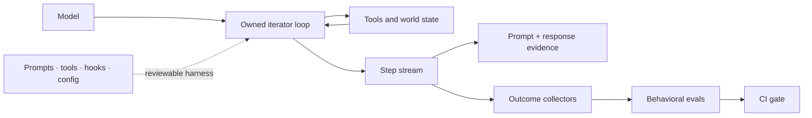

# Why looplet

Looplet is a Python SDK for owning a tool-calling agent's harness.
You can inspect each tool call and change how the loop handles prompts, tools, context, and policies.

A working demo still needs maintenance after deployment.
A prompt edit can break an existing case.
A tool change can produce different side effects.
A model upgrade can choose different calls.
Saved run evidence helps you investigate these changes.
Regression tests and outcome evals check their effects.

Keep failed cases and cases that already work.
Change the agent definition, then compare versions using captured responses or fresh model runs as appropriate.
Looplet supplies the execution and evidence used by these checks.
Keep improvement algorithms, experiment orchestration, and promotion decisions in your host or downstream packages.
Protected release checks must stay outside the code that a candidate can change.

## What “harness” means here

The model is one component. The **harness** is everything around it:

- the system prompt and task briefing;
- tool schemas and implementations;
- context, memory, and compaction policy;
- permissions, approvals, and stop conditions;
- the loop that connects model decisions to side effects;
- traces, outcome collectors, and behavioral evals.

Use ordinary Python functions and hooks to define these behaviors.
Package them as reviewable files when you need to version or share an agent.



## The workflow

### 1. Own the execution boundary

`composable_loop()` is a generator.
It yields a `Step` after a tool call has been handled.
The step contains the call, its arguments, result, and timing.
Your code can inspect it and stop before the next call.

```python
from contextlib import closing

with closing(composable_loop(llm=llm, tools=tools, hooks=hooks, task=task)) as steps:
    for step in steps:
        print(step.pretty())
        if should_pause(step):
            break
```

Use permission or pre-dispatch hooks to check a call before execution.
A yielded step describes a call that has already been handled.
Hooks are ordinary Python objects with callbacks at named points in the loop.

### 2. Make the harness reviewable

Package instructions, tools, hooks, configuration, and self-tests in an ordinary directory.
This [cartridge](cartridge.md) is the reusable, reviewable unit of agent behavior:

```text
agent.cartridge/
├── cartridge.json
├── config.yaml
├── runtime.yaml
├── prompts/system.md
├── tools/<name>/{tool.yaml, execute.py}
├── hooks/<order>_<name>/{config.yaml, hook.py}
└── evals/{cases/, collect_*.py, eval_*.py}
```

Use `looplet describe`, `looplet diff`, and `looplet hash` to inspect the agent version and review changes.
Load it into your application and run its self-tests after edits.
Cartridges are optional; direct Python functions use the same loop.

The model connection, credentials, and protected release checks stay with the
host. Moving the directory between runtimes also requires
[protocol-routed components](portability.md); a portable report is not proof
that candidate code is isolated.

### 3. Preserve evidence

[Provenance capture](provenance.md) writes the prompts, responses,
steps, stop reason, and metadata to human-readable files. A captured
response stream can be replayed through fresh tools, hooks, state, and
permissions without paying for another model call.

Captured-response replay holds model responses constant.
Tool code and side effects execute again.
It checks execution changes against the recorded decisions.
Use fresh model runs to evaluate prompt, model, or model-visible context changes.
See [experiments](experiments.md) for what each method can establish.

### 4. Grade outcomes

[Collectors and evals](evals.md) let the host inspect the world after a
run by rerunning tests, reading an artifact, or inspecting a database, then grade
that evidence. The default is outcome-grounded:

```python
def collect_tests(state):
    result = subprocess.run(["pytest", "-q"], check=False)
    return {"tests_passing": result.returncode == 0}


@eval_mark("required")
def eval_tests_pass(ctx):
    return ctx.artifacts["tests_passing"]
```

The live task omits grader-only expected data. Discovered required graders,
collector errors, malformed records, and missing cases fail closed in the CLI.
Cartridge evals are still editable self-tests; protected promotion requires a
host-owned runner and an isolation boundary outside candidate authority.

## Where looplet fits

| If you need… | Reach for… |
| --- | --- |
| A few lines around one simple experiment | A raw Python loop |
| A single-loop agent whose harness must be inspectable and regression-tested | **Looplet** |
| Durable multi-stage workflows, branching graphs, and managed checkpoints | A graph/workflow runtime |
| Shared dashboards, annotation queues, and hosted experiment analytics | A hosted eval/observability platform |
| A turnkey coding assistant or research swarm | A batteries-included agent product |

Looplet can coexist with the other rows. It can run inside a durable
job, export traces to an observability service, or expose one agent as
a tool to another system. It does not try to absorb those systems into
its core.

## Good fit

Use Looplet when:

- your agent is fundamentally one model calling tools in a loop;
- your team already reviews Python, files, pytest, and CI;
- prompt, tool, hook, or model changes need behavioral evidence;
- you need exact interception points without subclassing a framework;
- local artifacts and zero required core dependencies matter.

## Not a good fit

Choose something else when:

- the product is naturally a branching graph with durable node-level
  scheduling;
- you want a hosted dashboard to be the source of truth;
- you need a prebuilt assistant more than a toolkit;
- you do not want to own the loop, tools, or test contract.

Looplet focuses on the execution of one tool-calling loop and the evidence needed to test changes.
It does not supply a workflow scheduler, hosted dashboard, or optimizer.

## Run the regression example

The [failure-to-regression demo](regression-demo.md) is network-free and
executable. It captures a failing run, changes one tool line, replays
the same model decisions against fresh code, and turns an independent
world-state check from red to green.

If you already own a loop, the
[migration recipe](migrate.md#run-the-whole-recipe) applies the same proof to
existing code: it keeps the tool callables, replaces only the loop, and lands
one required grader that reads world state. It also says when keeping your raw
loop is the better call.

[Run the proof →](regression-demo.md){ .md-button .md-button--primary }
[Start with your own loop →](quickstart.md){ .md-button }
